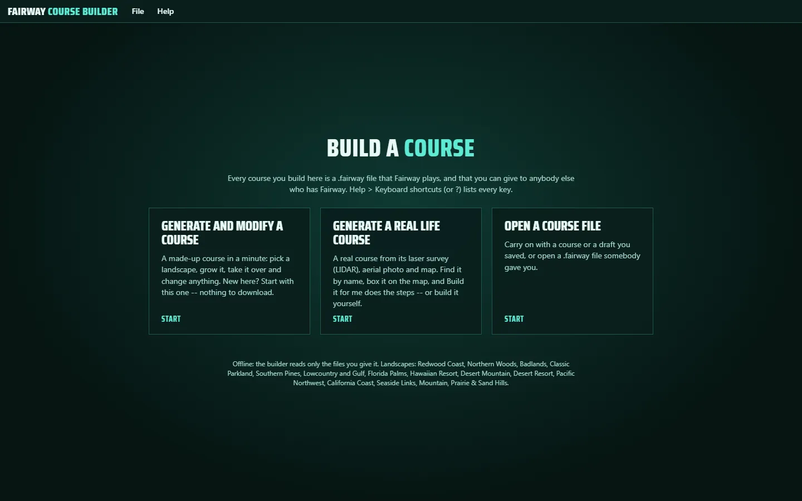
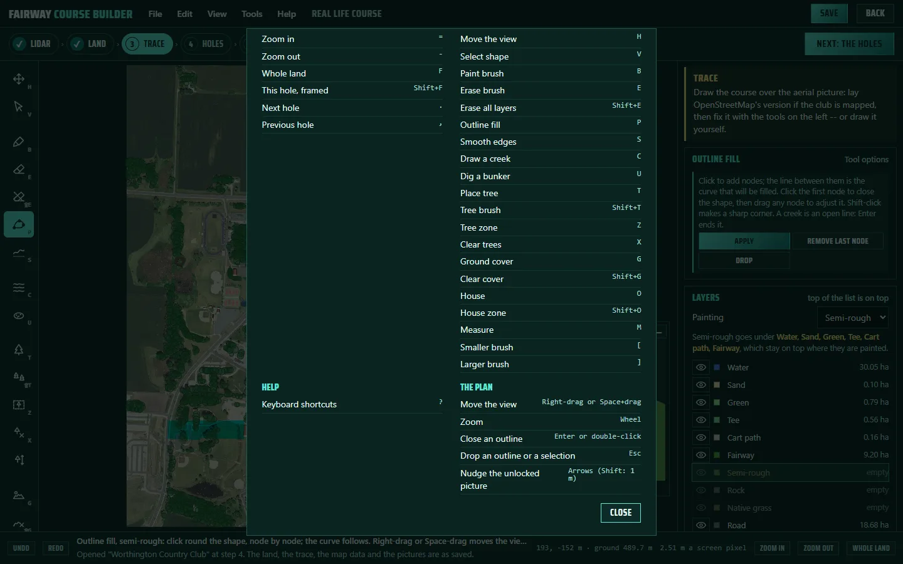
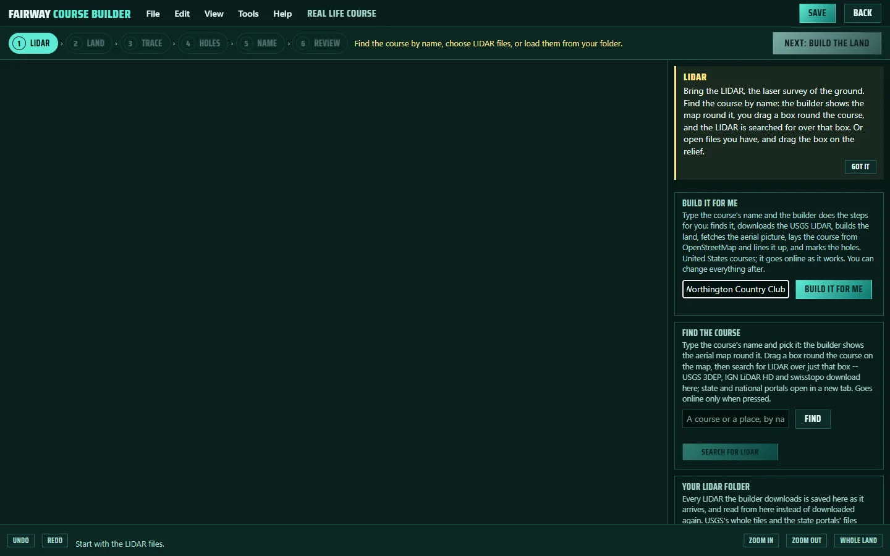
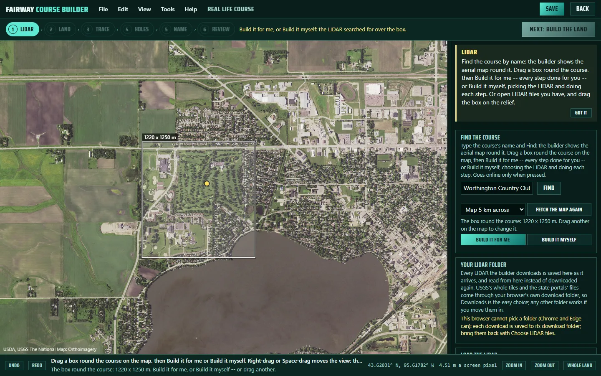
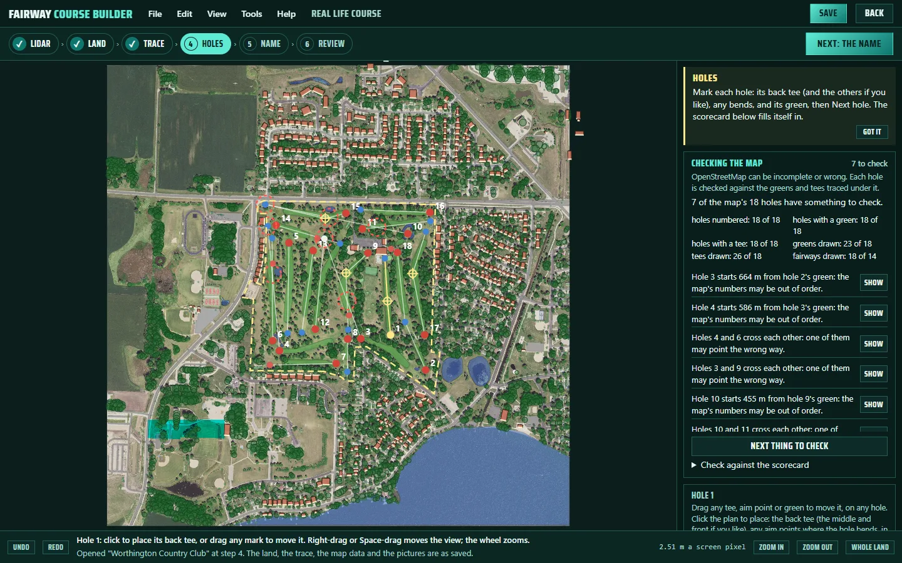
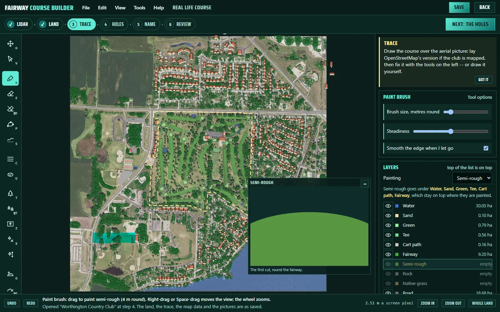
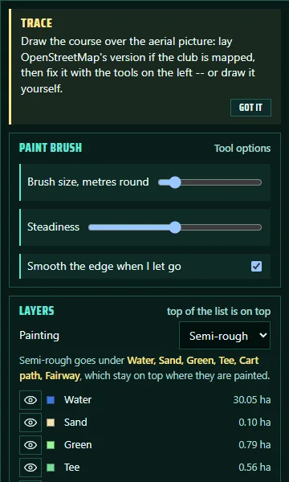
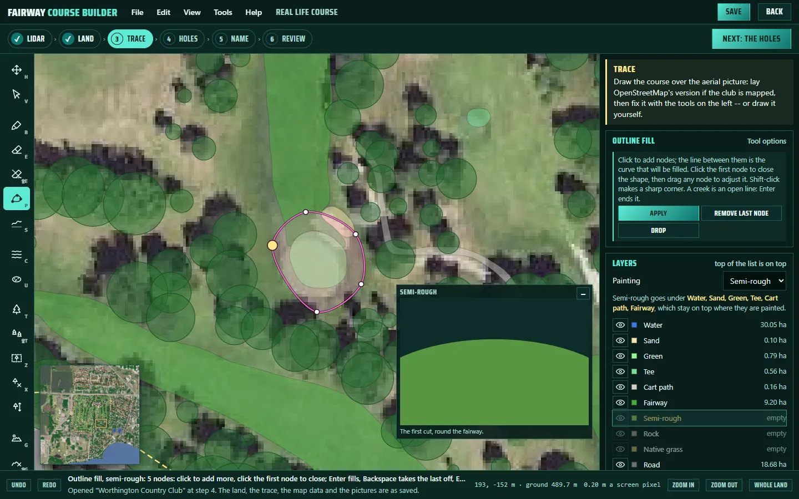
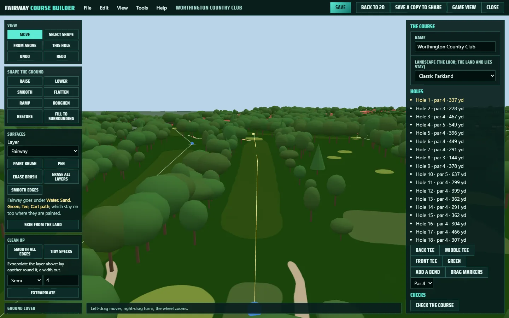
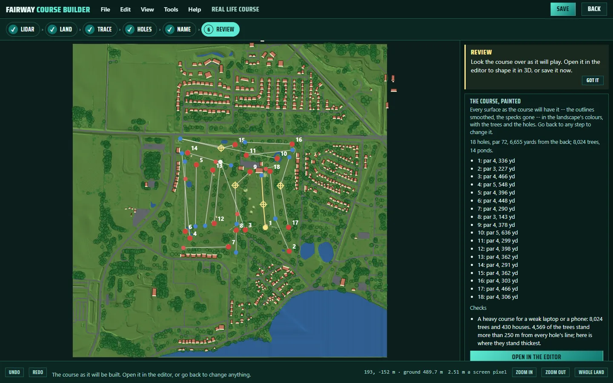

# Fairway Course Builder: a player's guide

Fairway Course Builder makes golf courses for Fairway: a made-up course you
grow and change, or a real course built from its laser survey (LIDAR), its
aerial photograph and its map. Everything it makes is a `.fairway` file that
Fairway plays and that you can give to anyone who has Fairway.

Open **Fairway Builder.html** (beside Fairway.html in the download). It works
offline; it goes online only when you ask it for something from the internet
-- a survey, a photograph, the map.

## Which door

- **Generate and modify a course** -- a made-up course in a minute: pick a
  landscape, grow it, take it over, change anything. New here? Start with this
  one: there is nothing to download, and every tool is there to try.
- **Generate a real life course** -- a real course, from its survey, its
  photograph and its map. Type its name and **Build it for me** does the steps,
  or do each step yourself.
- **Open a course file** -- carry on with a course or a draft you saved, or open
  a `.fairway` file somebody gave you.

## Finding your way round

Every working screen is laid out the same way, like a paint program:

- **The menus** along the top -- File, Edit, View, Tools, Help -- hold every
  command, with its key beside it. **?** (Help > Keyboard shortcuts) lists every
  key on the screen you are on.
- **The steps** (a real course): a row of chips -- a tick on each step done, the
  one you are on filled, the ones you cannot reach yet dimmed (hold the pointer
  over one to see why) -- what the step still needs, and **one Next button** at
  the right, always in the same place.
- **The tools** down the left, each with its key in the corner.
- **The panel** on the right: what the step is for, the tool's options, the
  layers, and sections that fold away.
- **The status bar** along the bottom: what the tool does, what just happened,
  where the pointer is and the ground's height there, Undo, Redo and the zoom.

On the plan, the wheel zooms, the right button or Space drags the view, **F**
shows the whole land, and a small map in the corner shows where you are when
zoomed in -- click it to go there.

## A real course, the quick way: Build it for me

Type the course's name (add its town if the name is common) and press **Build
it for me**. The builder:

1. finds the course (a golf course on the map wins over a town of the same
   name; if two courses share the name it asks which),
2. downloads the newest USGS survey covering the course,
3. builds the land,
4. fetches the sharpest free aerial photograph,
5. lays the course from OpenStreetMap and lines it up with the survey,
6. marks the holes from the map, with the doglegs it can read from the
   fairways,

and stops on the review -- or on the holes step if the map needs checking.
Worthington Country Club took under four minutes. It works for courses in the
United States, and everything it did can be changed afterwards.

## A real course by hand: the map, the box, the LIDAR

Under **Find the course**, type its name, press **Find**, and click the place
you mean. The builder shows the aerial map of the ground round it, 5 km
across (**Map 3 km** or **8 km** if the course is not on it). Drag a box round
the course with the left button -- up to 3 x 3 km -- and press **Search for
LIDAR**. Only that box, and 150 m past it for the land beyond the course, is
searched for and downloaded, so the download is no bigger than the course
needs. Each survey found shows how much of the box it covers.

When the LIDAR is in, the map gives way to the relief, and the box you drew
is the property. Drag another on the relief to change it, then **Next: build
the land**.

If you already have LIDAR files, **Choose LIDAR files** or **Load from the
folder** skip the map: the relief shows, and you drag the box on it.

## Checking the map

OpenStreetMap is drawn by volunteers: some courses are mapped in full, some in
part, some wrongly. When the holes come from the map, the holes step opens with
**Checking the map**: what the map holds against what the course needs, and
each thing to check -- a hole whose line runs across the rough instead of down
a fairway, a green or tee mark off any green or tee, two holes on one green,
lines that cross, a length that does not suit the par, a tee far from the last
green. Red rings mark them on the plan.

Each has **Show** (the hole, framed) and, where one suits, **Fix** -- the mark
moved onto the nearest green or tee, or the line turned down the fairway. The
fixes are guesses from the traced course: check each against the photograph.
When half the holes or more have something to check, the map is called
unreliable: go through every hole. **Find the doglegs** gives holes with no bend
the bend their fairway takes. **.** and **,** go to the next and previous hole.

## Drawing and correcting the course

**Layers.** Every surface is its own layer, top of the list on top, as in a
paint program. Click a layer to paint it. Paint goes *under* the layers above
it: semi-rough painted across a bunker leaves the bunker on top and the
semi-rough beneath it. The line under the layer you are painting says which
layers will stay on top, and when a stroke goes under one, its path flashes and
the status bar says so. The eye hides a layer from view (the course keeps it).

**The brush** (B) is steadied: it trails the pointer a little, so a shaky hand
draws a smooth line. **Steadiness** in the tool's options sets how much; 0
paints right under the pointer. **[** and **]** change its size.

**The pen** (P, Outline fill) draws a shape node by node: the curve through the
nodes is drawn as you go, and it is exactly what fills. Click the first node to
close the shape (it grows yellow when the pointer is on it), drag any node to
adjust it, then press **Enter**. Shift-click makes a sharp corner; Backspace
takes the last node off; Esc drops the shape. Tree zones, house zones, the
course boundary and creeks use the same pen.

**Select** (V) picks a shape, tree or house: drag it to move it, an anchor to
turn it. **Ctrl+C**, **Ctrl+V** (pastes at the pointer), **Ctrl+D** (a copy
beside it) and **Delete** work on what is selected. **Measure** (M) gives the
yards, metres and rise or fall between two clicks. **Skin from the land** paints
the landscape's rock on the steep ground in one go; hold **Before** to compare.

Undo (Ctrl+Z) says what it will undo, and the **History** section lists your
last changes with **Back to here**.

**The photograph** is kept in your file but never drawn in the game. If it sits
a little off, unlock it and drag it into line. Viewing has its brightness and
contrast, and USGS's photographs say when they were taken.

## The 3D editor

**Open in the editor** shows the course in 3D, with the same kind of tool
strip down the left and the options beside it. Shape the ground (raise, lower,
smooth, flatten, ramp), paint with the one brush and pen on the layer chosen,
dig bunkers, draw ponds and creeks, plant trees and houses; select anything and
press Delete to take it away. W A S D fly, Q and E go down and up, **G** shows
the course in the game's own picture. **Back to 2D** takes your 3D work back to
the plan.

## Saving, and playing it in Fairway

- **Your work is kept as you go** in this browser: a closed tab costs a few
  minutes at most, and door 2 offers it back next time.
- **Save** (Ctrl+S) in the top bar keeps door 2's draft, which the builder
  reopens just where you were.
- **Save the course for Fairway**, on the review (or Save in the 3D editor),
  writes the `.fairway` file. In **Fairway.html**: Saved courses > Import
  courses from a file, or drop the file there. It joins your shelf; play it
  from Play > a saved course.

## Experimental

The **auto trace** guesses the greens, tees, fairways, sand and water from the
survey and the photograph. It is a rough start you will need to fix by hand,
so it is folded away under **Experimental**. OpenStreetMap, where the course is
mapped, is a much better start.
