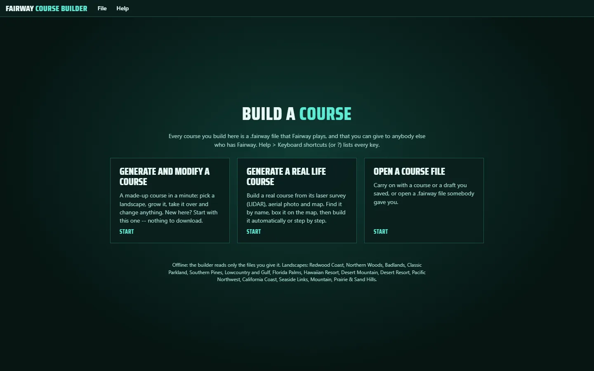
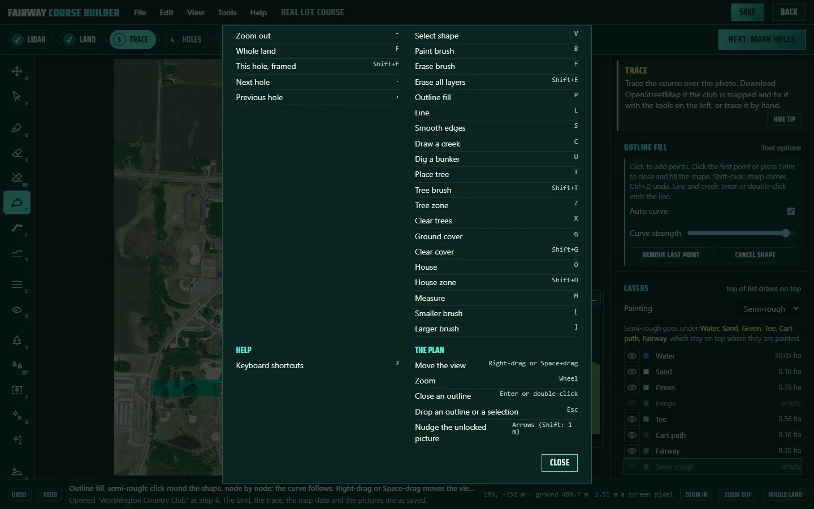
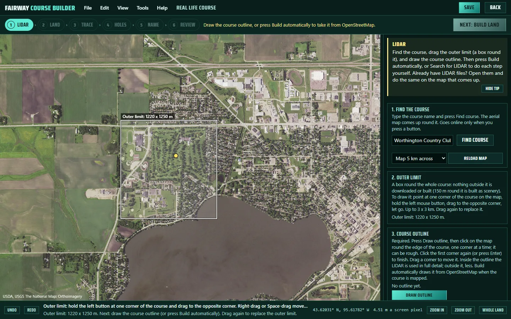
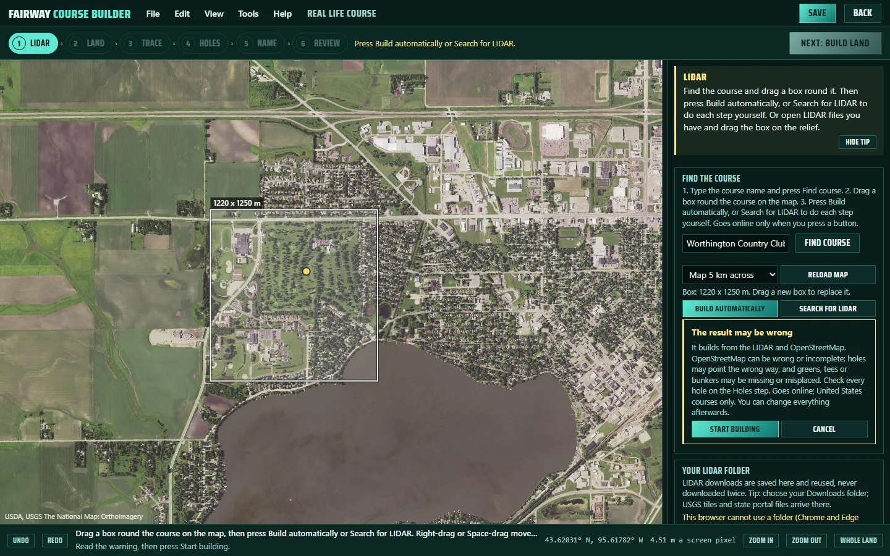
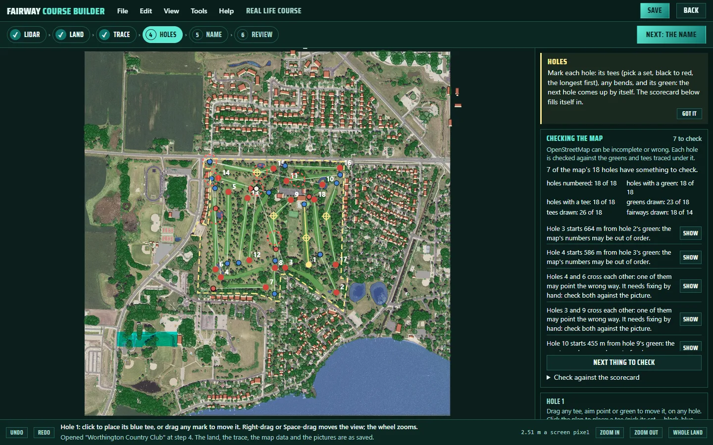
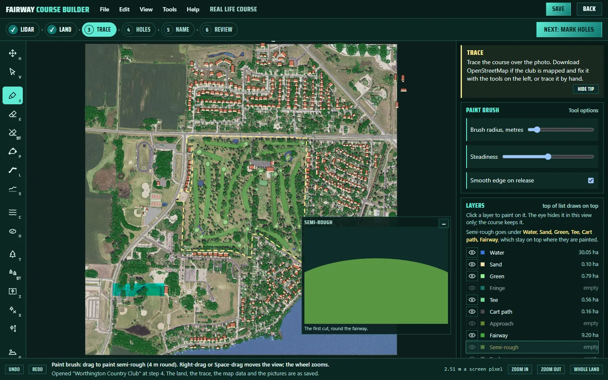
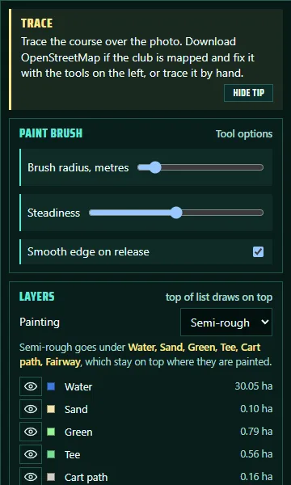
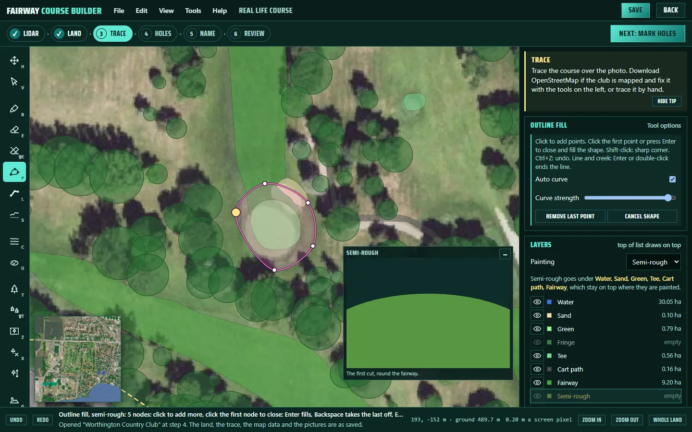
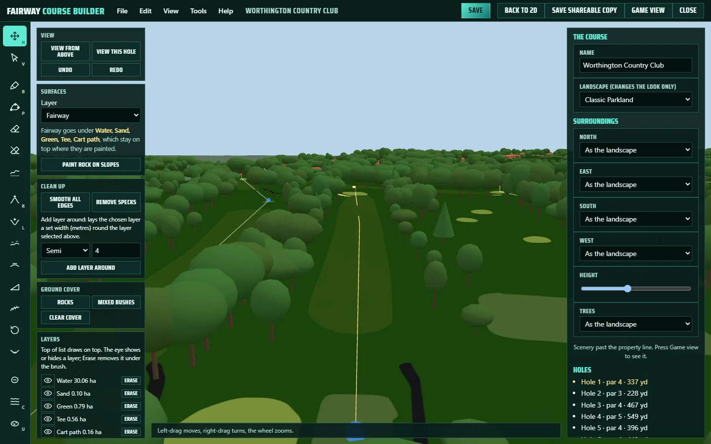
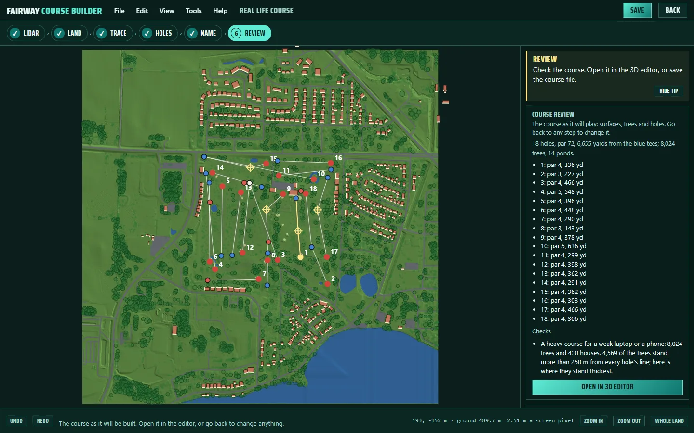

# Fairway Course Builder: a player's guide

Fairway Course Builder makes golf courses for Fairway: a made-up course you
grow and change, or a real course built from its laser survey (LIDAR), its
aerial photograph and its map. Everything it makes is a `.fairway` file that
Fairway plays and that you can give to anyone who has Fairway.

Open **Fairway Builder.html** (beside Fairway.html in the download). It works
offline; it goes online only when you ask it for something from the internet
-- a survey, a photograph, the map.

## Which door

- **Generate and modify a course** -- a made-up course in a minute: pick a
  landscape, grow it, take it over, change anything. New here? Start with this
  one: there is nothing to download, and every tool is there to try. Its
  sliders open on Fairway's starting course -- the settings the course of the
  week is grown with: wide fairways, a few doglegs, large shaped greens, a
  lake and plenty of trees -- and every one of them can be moved.
- **Generate a real life course** -- a real course, from its survey, its
  photograph and its map. Find it by name, box it on the map, then press
  **Build automatically** -- or **Search for LIDAR** to do each step yourself.
- **Open a course file** -- carry on with a course or a draft you saved, or open
  a `.fairway` file somebody gave you. It lists what is in your **courses
  folder**, newest first; **Open another file…** opens one from anywhere else.

**Your courses folder.** The first time you save, the builder asks you to pick
a folder for your courses (and, on a real course before the Name step, asks
for the course's name). From then on every Save goes straight into that folder
with no dialog, named after the course, and Open lists it. If a course of the
same name is already there and it is not the one you are working on, you are
asked whether to replace it or save beside it. **Change folder** in either box
picks another. (Chrome and Edge; other browsers save to their downloads.)

## Finding your way round

Every working screen is laid out the same way, like a paint program:

- **The menus** along the top -- File, Edit, View, Tools, Help -- hold every
  command, with its key beside it. **?** (Help > Keyboard shortcuts) lists every
  key on the screen you are on.
- **The steps** (a real course): a row of chips -- a tick on each step done, the
  one you are on filled, the ones you cannot reach yet dimmed (hold the pointer
  over one to see why) -- what the step still needs, and **one Next button** at
  the right, always in the same place.
- **The tools** down the left, each with its key in the corner.
- **The panel** on the right: what the step is for, the tool's options, the
  layers, and sections that fold away.
- **The status bar** along the bottom: what the tool does, what just happened,
  where the pointer is and the ground's height there, Undo, Redo and the zoom.

On the plan, the wheel zooms, the right button or Space drags the view, **F**
shows the whole land, and a small map in the corner shows where you are when
zoomed in -- click it to go there.

## A real course: find it, box it, build it

Step 1's panel runs in four parts, in order:

1. **Find the course.** Type the course's name (add its town if the name is
   common) and press **Find course**. A golf course on the map is taken at
   once, even over a town of the same name; if the search finds several
   places, click the one you mean. The aerial map comes up round it, 5 km
   across (**Map 3 km** or **8 km** if the course is not on it).
2. **Outer limit.** A box round the whole course: nothing outside it is
   downloaded or built (150 m round it is built as scenery). To draw it, point
   at one corner of the course on the map, hold the left mouse button, drag
   to the opposite corner and let go. Up to 3 x 3 km; drag again to replace it.
3. **Course outline** (required). Press **Draw outline** and click round the
   edge of the course, one corner at a time; it can be rough. Click the first
   corner again (or press Enter) to finish; drag a corner to move it. Inside
   the outline the LIDAR is used in full detail, and on a large property the
   ground round greens, tees and bunkers is built at half a metre; outside it
   less is used. **Build automatically** draws it from OpenStreetMap when the
   course is mapped. Putting surfaces are always smoothed, so a putt holds its
   line.
4. **Build the course**: one of the two ways below.

### Build automatically

Press **Build automatically**. It first warns that **the result may be
wrong** -- OpenStreetMap's map of a course can be wrong or incomplete, so a
hole may point the wrong way or a green may be missing. Press **Start
building** to go on, or **Cancel**. The builder:

1. downloads the newest USGS survey covering the most of the box,
2. builds the land,
3. fetches the sharpest free aerial photograph,
4. lays the course from OpenStreetMap and lines it up with the survey,
5. marks the holes from the map, with the doglegs it can read from the
   fairways,

and stops on the review -- or on the holes step if the map needs checking.
Worthington Country Club took under four minutes. It works for courses in the
United States, and everything it did can be changed afterwards. Look every
hole over before you play it.

### Search for LIDAR

Press **Search for LIDAR**: every source of LIDAR over the box is listed, with
how much of the box each survey covers. Download one (or open a state portal's
page, and put what it gives you in your LIDAR folder). When the LIDAR is in,
the map stays, with where the LIDAR reaches outlined yellow; the outer limit
and outline you drew are kept, and you can drag either again. **Next: build
land** builds the land at once; then the trace, the holes, the name and the
review, each by hand.

If you already have LIDAR files, **Open LIDAR files** or **List folder
files** bring up the aerial map round them: drag the outer limit and draw
the outline on it. (Only where no map covers the files, or they do not say
where they lie, a grey relief of the LIDAR shows to draw on instead.)

## Hole checks

OpenStreetMap is drawn by volunteers: some courses are mapped in full, some in
part, some wrongly. When the holes come from the map, the holes step opens with
**Hole checks**: what the map holds against what the course needs, and
each thing to check -- a hole whose line runs across the rough instead of down
a fairway, a green or tee mark off any green or tee, two holes on one green,
lines that cross, a length that does not suit the par, a tee far from the last
green. Red rings mark them on the plan.

Each has **Show** (the hole, framed) and, where one suits, **Fix** -- a mark a
few metres off moved onto the nearest green or tee, or a bend down the fairway.
A hole the map drew to the **wrong green** is only flagged: it needs fixing by
hand -- drag its green or tee onto the right one, with the photograph to go by.
(The builder used to guess the right green, and was wrong too often.)

**Tee sets.** A course has up to six, longest first: **black, blue, white,
silver, gold, red**. On the holes step, pick a set and click where its tee is
(each tee shows on the plan in its set's colour), then click the green: the
next hole still to mark comes up by itself, its tee in hand. The scorecard
shows a column for each set the course has. From OpenStreetMap
the sets come from the map's tags where it has them, and otherwise from how
many tee boxes the holes have, the farthest box the longest set. In Fairway a
golfer whose set the course lacks plays the nearest one it has.
When half the holes or more have something to check, the map is called
unreliable: go through every hole. **Add dogleg aim points** gives holes with no bend
the bend their fairway takes. **.** and **,** go to the next and previous hole.

## Drawing and correcting the course

**Layers.** Every surface is its own layer, top of the list on top, as in a
paint program. Click a layer to paint it. Paint goes *under* the layers above
it: semi-rough painted across a bunker leaves the bunker on top and the
semi-rough beneath it. The line under the layer you are painting says which
layers will stay on top, and when a stroke goes under one, its path flashes and
the status bar says so. The eye hides a layer from view (the course keeps it).

**The brush** (B) is steadied: it trails the pointer a little, so a shaky hand
draws a smooth line. **Steadiness** in the tool's options sets how much; 0
paints right under the pointer. **[** and **]** change its size.

**The pen** (P, Outline fill) draws a shape node by node: the curve through the
nodes is drawn as you go, and it is exactly what fills. Click the first node
again (it grows yellow when the pointer is on it), or press **Enter**, and the
shape closes and fills at once -- **Ctrl+Z** takes it back if it is not right.
Shift-click makes a sharp corner; Backspace takes the last node off; Esc drops
the shape. Tree zones, house zones, the
course boundary and creeks use the same pen. **Auto curve** turns the curving
off (straight lines point to point) and **Curve strength** sets how much it
bows; both hold for every pen tool.

**The line** (L) is the pen without closing: click along a path or a road and
press **Enter** or double-click to lay it on the chosen layer, **Line width**
metres wide, with round or square **Ends**. Square ends make square bends
too; round ends make round ones.

Every edge goes into the course straight where you painted it straight, its
corners kept and its curves smooth, and the plan draws it that way a moment
after each stroke. **Smooth edges** is for edges you want rounder than you
painted them, not for the little steps of the squares: those the course
never has.

**The house** (O): a click stands a house of the **Width** and **Depth** set in
its options; drag corner to corner to stand one the size of the box. Its front
faces the nearest fairway, green or tee. A house picked with **Select** shows
its own Width and Depth to change.

**Select** (V) picks a shape, tree or house: drag it to move it, an anchor to
turn it. **Ctrl+C**, **Ctrl+V** (pastes at the pointer), **Ctrl+D** (a copy
beside it) and **Delete** work on what is selected. **Measure** (M) gives the
yards, metres and rise or fall between two clicks. **Paint rock on slopes** paints
the landscape's rock on the steep ground in one go; press and hold **Hold to
show before** to compare.

**Clean up**: **Smooth edges** rounds ragged edges (thin shapes such as cart
paths are kept whole) and **Remove specks** takes off tiny patches; each has a
**Layer** picker (every layer, or one). **Normalize width** lays every cart path
(1.8 m to start) or every street (6 m) again at one width; paths that meet still
meet where they did, and wide areas such as parking lots are kept as drawn.
**Add layer around** lays one layer in
a band round another: pick **Around** (fairway), **Lay** (semi-rough) and the
**Width**.

**Outside the course**: draw the course boundary, then in the **Fill outside
boundary** box choose what happens outside it -- surfaces and houses kept or
removed, the ground, the trees (replaced by a new wood, kept, or removed),
where new trees may stand (only where the LIDAR saw trees, or everywhere), how
many a hectare (empty: as many as the LIDAR found) and how much their heights
vary -- and press **Fill outside boundary**.

Undo (Ctrl+Z) says what it will undo, and the **History** section lists your
last changes with **Undo to here**.

**The photo** is kept in your file but never drawn in the game. If it sits a
little off, press **Unlock photo**, drag it into line, and press **Lock
photo**. Viewing has its brightness and contrast, and USGS's photos say when
they were taken.

## The 3D editor

**Open in 3D editor** shows the course in 3D, with the same kind of tool
strip down the left and the options beside it. Shape the ground (raise, lower,
smooth, flatten, ramp), paint with the one brush and pen on the layer chosen,
dig bunkers, draw ponds and creeks, plant trees and houses; select anything and
press Delete to take it away. W A S D fly, Q and E go down and up, **G** shows
the course in the game's own picture. **Back to 2D** takes your 3D work back to
the plan.

### Surroundings

In the panel on the right, under **Landscape**, **Surroundings** chooses what
stands past the edge of your course -- the land nobody plays, out to the
horizon.

- **North, East, South, West**: one choice for each side.
  - **As the landscape** -- whatever that landscape has there anyway.
  - **Open country** -- the course's own ground carried on, nothing raised.
  - **Rolling hills**
  - **A mountain range**
  - **One big mountain** -- on one side only; ask for it on a second side and
    that side gets a mountain range.
  - **Mesas** -- flat-topped tables with cliffs.
  - **The sea**
  - **Sea and islands**
  - **A lake** -- water, with a far shore of low hills beyond it.
- **Height**: how high the hills, ranges and mesas stand, from about a third
  of their usual height to twice it.
- **Trees**: how wooded the land round the course is -- As the landscape, No
  trees, A few, Half wooded or Thick woods. The trees are the landscape's own
  kinds. Just past your property line the woods follow your own course's
  edge -- thick where your trees reach the line, open where they do not --
  and blend into the setting you chose over the next couple of hundred
  metres. No trees means none at all, your edge included.

It is scenery. Nothing on your course changes, and water on a side stands
below the lowest of your land, so it never floods a hole. Press **Game view** (G) to see it. It is saved with the
course, and Fairway draws it when the course is played. It is not an Undo
step: set a side back to **As the landscape** to take a choice away.

## Saving, and playing it in Fairway

- **Your work is kept as you go** in this browser: a closed tab costs a few
  minutes at most, and **Restore draft** brings it back next time.
- **Save** (Ctrl+S) in the top bar keeps door 2's draft, which the builder
  reopens just where you were.
- **Save course file**, on the review (or Save in the 3D editor),
  writes the `.fairway` file. In **Fairway.html**: Saved courses > Import
  courses from a file, or drop the file there. It joins your shelf; play it
  from Play > a saved course.

## Experimental

The **auto trace** guesses the greens, tees, fairways, sand and water from the
survey and the photograph. It is a rough start you will need to fix by hand,
so it is folded away under **Experimental**. OpenStreetMap, where the course is
mapped, is a much better start.
